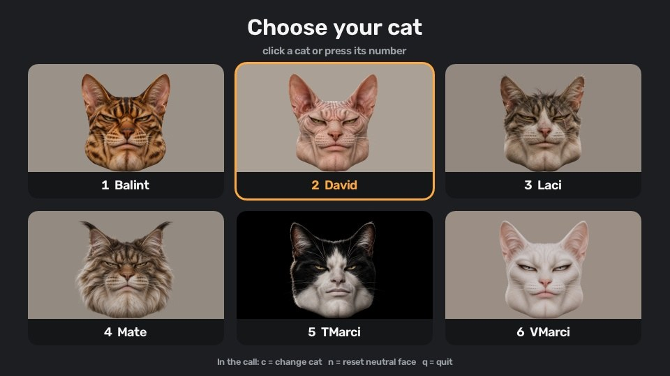
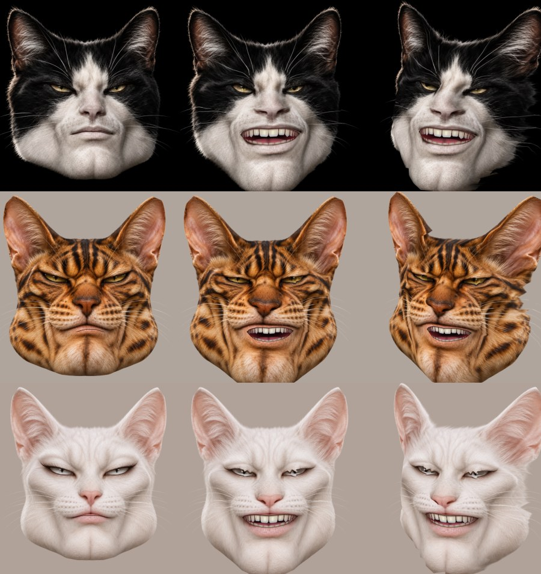

# Cat Cam

Be Woofgang, a golden retriever, in your Zoom calls. He is a real 3D head that
turns, nods and tilts with your head, copies your whole face (brows, blinks,
cheeks, smile) and opens his own mouth with yours, his jaw swinging down, while
the side of his head that turns away from the light falls into shadow. Your
hands become his paws, toe by toe: the top of the paw when you show the back of
your hand, the toe beans when you show your palm. When you talk, the call hears
him bark instead of your voice. When you sit still, he breathes and looks
around on his own. And you can put any picture or video behind him.

Your own face is never sent anywhere. Only the drawn cat goes out to the
virtual camera, and everything runs locally on your computer.





## Easy install (Mac with Apple Silicon)

No programming tools needed: download **Cat-Cam-<version>.dmg** from the
[Releases page](https://github.com/tarrcimar/cat-cam/releases), open it and
follow *Read me first.txt* inside. In short: drag Cat Cam to Applications,
set up OBS's virtual camera once (step 2 below), and the first time you open
Cat Cam allow it under *System Settings → Privacy & Security → Open Anyway*.

The rest of this page is for running it from the code instead.

## What you need

- **macOS**. It is developed and tested on Apple Silicon. Windows should work
  too (pyvirtualcam and OpenGL both support it) but is untested.
- A webcam.
- [**uv**](https://docs.astral.sh/uv/), which installs Python and all
  libraries for you.
- [**OBS Studio**](https://obsproject.com). Only its virtual camera driver is
  used; OBS itself stays closed.

## One-time setup

1. **Install uv**:

   ```sh
   curl -LsSf https://astral.sh/uv/install.sh | sh
   ```

2. **Install OBS and enable its virtual camera.** Run
   `brew install --cask obs` or download it from obsproject.com. Then:
   1. Open OBS and click **Start Virtual Camera**.
   2. When macOS asks, allow the system extension. You may need to approve it
      under *System Settings → General → Login Items & Extensions*.
   3. Click **Stop Virtual Camera** and **quit OBS**.

   You only do this once. Afterwards, keep OBS closed while Cat Cam runs, or
   it takes the virtual camera for itself.

3. **Allow keyboard access for your terminal app.** A few keyboard
   shortcuts also work while Zoom is in front, which macOS only allows with
   *Input Monitoring*. macOS usually does **not** ask for it by itself:
   1. Open *System Settings → Privacy & Security → Input Monitoring*.
   2. If your terminal app (Terminal, iTerm, Warp, ...) isn't in the list,
      click **+** at the bottom, choose it from *Applications*, and add it.
   3. Switch it on.
   4. **Quit and reopen the terminal app** (⌘Q). The permission only takes
      effect after a restart.

4. **Optional: his voice.** For the call to hear barks instead of your voice,
   install the free BlackHole virtual microphone:

   ```sh
   brew install blackhole-2ch
   ```

   Then, in Zoom, choose **BlackHole 2ch** as the microphone (*Settings →
   Audio → Microphone*). Cat Cam listens to your real microphone and sends
   the barks there. Without BlackHole everything else works, and the call
   hears your real voice.

5. **Get the code**:

   ```sh
   git clone https://github.com/tarrcimar/cat-cam.git
   cd cat-cam
   ```

## Run it

```sh
uv run cat-cam
```

The first run downloads the libraries, which takes a minute. macOS then asks
whether your terminal may use the camera; allow it. If you said no, enable it
under *System Settings → Privacy & Security → Camera* and run again.

A window opens with the cat picker. Click a cat, or press its number.

In Zoom, go to *Settings → Video → Camera* and choose **OBS Virtual Camera**.
Do the same in any other app (Meet, Teams, FaceTime, ...). If the camera is
not listed, restart Zoom while Cat Cam is running.

Keep a relaxed face for the first second: the cat compares your face against
how it looks at the start. Looking into the camera is looking at the viewer,
wherever you sit. If the cat looks grumpy while you are relaxed, or you'd
rather it faced the viewer while you look elsewhere (at the screen, say),
press `n` while doing that.

Raise your hands into the camera's view for paws. Turn a hand around to
show the other side of the paw. Each toe follows one of your fingers: curl a
finger and its toe curls in, make a fist and they all do.
Turn on **Tail** in the top left corner of the window (or press `t`) for the
cat's tail: while only one of your hands is in view, it lifts the tip of
the tail instead of being a paw, and the rest of the tail rises from below,
trails behind, curls and swishes on its own. Show both hands and they are
two paws again. Turn it off for paws only.

The **3D head** switch next to it (or `d`) is on to begin with: turn it off
for the flat photo head, which is lighter on older Macs. (Cats without a 3D
head, see [docs/3d-heads.md](docs/3d-heads.md), don't have the switch.)

Turn on **Background** (or press `b`) and pick a picture or a video: it goes
behind the animal, in place of the plain backdrop. A video plays on a loop.
Turn it off and on again to pick another.

When you talk (and BlackHole is set up, see above), every syllable you say
comes out as a bark, as loud and as high or low as you said it. When you sit
still and quiet for a few seconds, he breathes, sways and looks around on his
own, until you move or talk again.

### Keys (in the Cat Cam window)

| Key        | What it does                                              |
|------------|-----------------------------------------------------------|
| `1`, `2`, ... | switch cat, when there are several                     |
| `c`        | open the cat picker (the call keeps showing your cat)     |
| `Esc`      | close the picker                                          |
| `t`        | tail on/off (same as the Tail switch)                     |
| `d`        | 3D head on/off, for cats that have one                    |
| `b`        | background on/off (on asks for a picture or video)        |
| `n`        | "this is my neutral face, looking at the viewer": recalibrate face and head pose |
| `q`        | quit (closing the window or Ctrl+C also works)            |

The preview in the window is mirrored, like a mirror. The call gets the
unmirrored picture, just as a normal camera would send.

### Options

```sh
uv run cat-cam --camera 1             # use another webcam (e.g. if your iPhone camera opens)
uv run cat-cam --mic "USB"            # listen to another microphone (part of its name)
uv run cat-cam --background beach.jpg # start with this picture or video behind the animal
```

`uv run python -m catcam.voice --list` lists the microphones;
`uv run python -m catcam.voice` lets you hear the barks in your headphones.

## Troubleshooting

| Problem | Fix |
|---|---|
| `Cannot open webcam` | Allow camera access for your terminal (see above). If you have several cameras, try `--camera 1`. |
| Error about the virtual camera | Do the OBS setup above, and make sure OBS is **not** running. |
| Zoom shows a black picture | OBS is probably running; quit it and restart Cat Cam. |
| Zoom does not list "OBS Virtual Camera" | Restart Zoom while Cat Cam is running. |
| The cat looks off while you are relaxed | Press `n` with a neutral face. |
| "Looking for your face..." | Face the camera and make sure your face is lit. |
| The call hears your real voice | Choose **BlackHole 2ch** as the microphone in Zoom. If Cat Cam says no virtual microphone was found, install BlackHole (see above) and restart Cat Cam. |
| "BlackHole is installed but macOS hasn't loaded it yet" | Run `sudo killall coreaudiod` (or restart the Mac), then restart Cat Cam. |
| No barks at all | Allow microphone access for your terminal under *System Settings → Privacy & Security → Microphone*. |

## Add your own cat

1. Put a portrait in `all_cats/<Name>.png`. It works best when the face looks
   straight at the camera with the mouth closed, against a plain background.
2. Prepare it. This cuts the cat out and finds its face, and takes about
   10 seconds per cat:

   ```sh
   uv run --group prepare python -m catcam.prepare
   ```

   The results go to `assets/cats/<Name>/`. Already prepared cats are skipped;
   add `--force` to redo them, or name cats to do only those.
   Optionally add paw photos next to it: `all_cats/<Name>PawsFront.png`
   (the front legs seen from the front, as if the cat stood facing you) and
   `all_cats/<Name>PawsBack.png` (the soles). In each, put the left paw on
   the left and the right paw on the right, separated by a vertical purple
   line. `prepare` cuts them out too; a cat without paw photos gets drawn
   paws in its colours.
   If the mouth ends up in the wrong place (it can on faces that aren't
   cat-like, such as a dog's), write where the lips meet in
   `all_cats/<Name>Mouth.txt` and prepare it again with `--force`; see
   [docs/3d-heads.md](docs/3d-heads.md#how-the-eyes-and-mouth-work).
3. Run `uv run cat-cam`. The new cat appears in the picker.
4. Optionally give it a 3D head, generated from the same portrait on your
   Mac: see [docs/3d-heads.md](docs/3d-heads.md).

## Tuning

These constants sit at the top of their files:

| Constant | File | Effect |
|---|---|---|
| `EXPRESSION_GAIN` | `catcam/app.py` | how exaggerated the cat's expressions are (1 = same as you) |
| `EXPRESSION_MIN_CUTOFF`, `EXPRESSION_BETA` | `catcam/app.py` | face smoothing: lower cutoff means less jitter, higher beta means less lag |
| `ROTATION_MIN_CUTOFF`, `ROTATION_BETA` | `catcam/app.py` | the same for head movement |
| `BLINK_RANGE` | `catcam/app.py` | how far you close your eyes before the cat blinks |
| `FLATTEN`, `PERK`, `TWITCH_EVERY` | `catcam/ears.py` | how far the ears move, and how often they twitch |
| `STRENGTH`, `LIGHT` | `catcam/lighting.py` | how much turning the head changes its shading, and where the light comes from |
| `PAW_SIZE` | `catcam/paws.py` | paw size relative to your hand |
| `LENGTH`, `SWISH`, `DRAG`, `SWITCH_FRAMES` | `catcam/tail.py` | how long the tail is, how much it sways by itself, how quickly it calms down, and how long a change between one and two hands must last before the tail follows |
| `TOP_MARGIN`, `CHIN_LINE` | `catcam/cat_mesh.py` | how much of the screen the cat fills |
| `JAW_HINGE`, `OWN_JAW_MAX` | `catcam/head3d.py` | where a 3D head's own jaw swings from, and how far it opens |
| `STILL_AFTER`, `BREATHING`, `SWAY`, `LOOK` | `catcam/idle.py` | how long you must be still before he acts on his own, his breathing, his sway, and how far he looks around |
| `ABOVE_NOISE`, `MIN_GAP`, `PITCH_FOLLOW` | `catcam/voice.py` | how loud you must talk to bark, the shortest time between barks, and how much the bark's pitch follows yours |

## How it works

1. MediaPipe tracks 478 points on your face plus your hands, from the webcam.
2. Each cat has the same 478 points, found once by `catcam.prepare`. The
   cats have human-like faces, so the human face model fits them.
3. Your points are aligned to your neutral face, which removes head position,
   rotation and distance. What remains is your expression. That is mapped onto
   the cat's points (`catcam/face_motion.py`).
4. The cat photo is a textured 3D mesh. It is deformed by your expression,
   rotated by your head pose and drawn with OpenGL, shaded by how much each
   part turned toward or away from the light (`catcam/lighting.py`). The
   mouth's inside and cat teeth are drawn in the gap between the lips,
   coloured to match the cat's lips (`catcam/cat_mesh.py`).
5. Blinks lower the cat's eyelids in its texture (`catcam/cat_face.py`), the
   ears bend about a hinge below their tips (`catcam/ears.py`), and paws are
   drawn where your hands are (`catcam/paws.py`), showing their top or their
   sole depending on which way your hand faces. A tail (`catcam/tail.py`) is
   a chain of points whose tip is pulled toward your hand; the rest is
   simulated with momentum, even bending and a bend limit, and wrapped in the
   skin of the cat's paw photo.
6. A 3D head (`catcam/head3d.py`) is tied to the photo cat's face points, so
   it takes on the same expressions. One with its own mouth, like Woofgang's,
   has its lower jaw found and cut free when it is imported: it grows over the
   model from the lower lip, the upper face from the upper lip, and they meet
   in the slit between the lips (`catcam/head3d_import.py`). The jaw then swings
   about its hinge as far as your lower lip drops, showing teeth, gums, a
   palate and a tongue modelled in Blender, a cat's or a dog's
   (`catcam/mouth3d.py`, `tools/mouth_model.py`).
7. While you are still and quiet, `catcam/idle.py` adds breathing, a sway and
   glances to the head. A background picture or video goes wherever the
   animal isn't (`catcam/background.py`).
8. The frame goes to the OBS virtual camera through pyvirtualcam. Your
   microphone goes through `catcam/voice.py`, which finds the syllables in
   your loudness and plays a bark for each, out to the BlackHole virtual
   microphone.

## Development

Want to contribute or make a release? See [CLAUDE.md](CLAUDE.md).

```sh
uv run pytest          # tests, including render checks on every cat
uv run ruff check .    # lint
uv run cat-cam --check # load and draw every cat once, without a camera
```

To build the standalone app and its disk image (`dist/Cat-Cam-<version>.dmg`)
on an Apple Silicon Mac:

```sh
packaging/build_mac.sh
```

```
catcam/
  app.py           main loop: webcam -> tracking -> render -> virtual camera
  picker.py        the cat picker
  cats.py          finding and loading prepared cats
  cat_mesh.py      the 3D head mesh and its OpenGL rendering
  cat_face.py      eyelids
  ears.py          ear movement
  lighting.py      shading as the head turns
  face_motion.py   expression transfer
  head_pose.py     head rotation and the One Euro smoothing filter
  idle.py          what the animal does by itself while you are still
  voice.py         your voice as barks, out to the virtual microphone
  background.py    a picture or video behind the animal
  paws.py          paws
  tail.py          the tail: a chain of points simulated like a real tail
  paw_photos.py    turns paw photos into paw sprites (used by prepare)
  prepare.py       turns all_cats/*.png into assets/cats/*
  landmark_fit.py  finds a cat's face points (used by prepare)
  head3d.py        3D heads, behind the 3D head switch
  glass.py         the window's glass panels, switches and text
  mouth3d.py       a 3D head's teeth, tongue and jaw (sets made by tools/mouth_model.py)
  head3d_import.py turns a generated .glb head into a cat's 3D head
all_cats/          source portraits
assets/cats/       prepared cats (cutout + face points, 3D heads), used at runtime
assets/mouth/      3D teeth, gums, palate and tongue, a cat's and a dog's
docs/3d-heads.md   how to make a 3D head
tools/             3D head helpers: TRELLIS.2 install and fixes, a render sheet, the mouth model
models/            MediaPipe face and hand models
packaging/         the standalone macOS app: PyInstaller spec, icon, build script
```

The MediaPipe models in `models/` are by Google and licensed under Apache 2.0.
Woofgang's bark (`assets/cats/Woofgang/voice/bark.ogg`) is CC0: a recording by
Geoff-Bremner-Audio on [Freesound](https://freesound.org/s/688201/), as cleaned
up for [Space Station 14](https://github.com/space-wizards/space-station-14).
